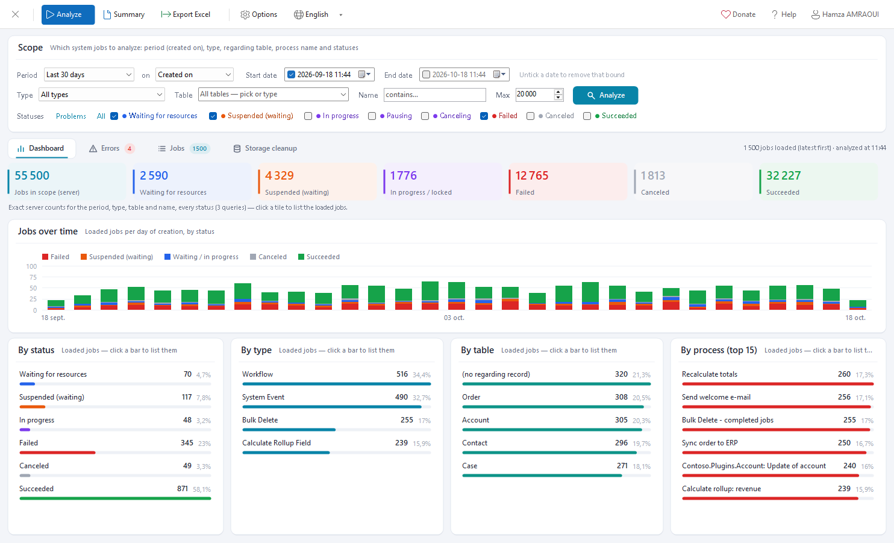
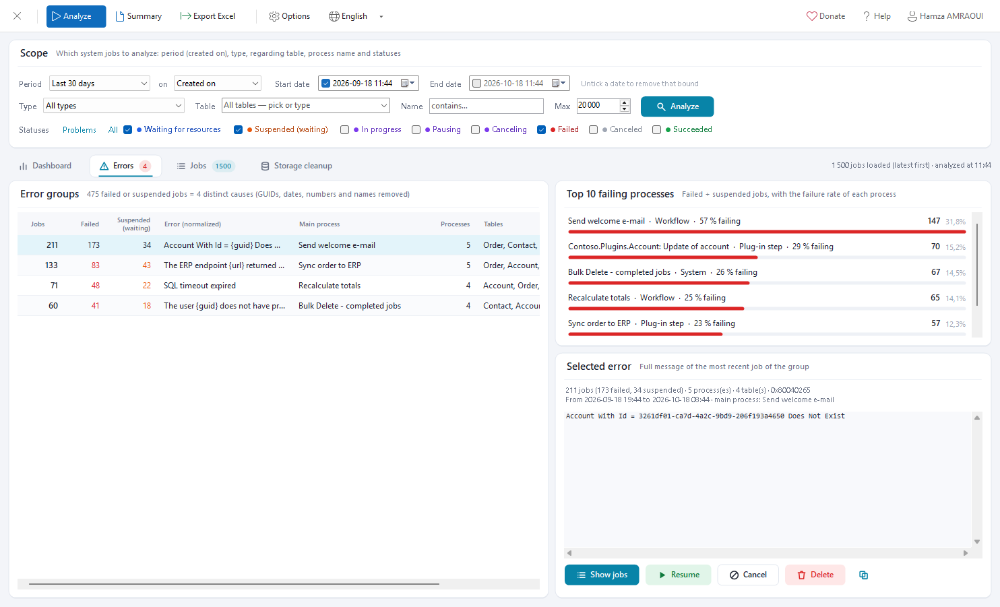
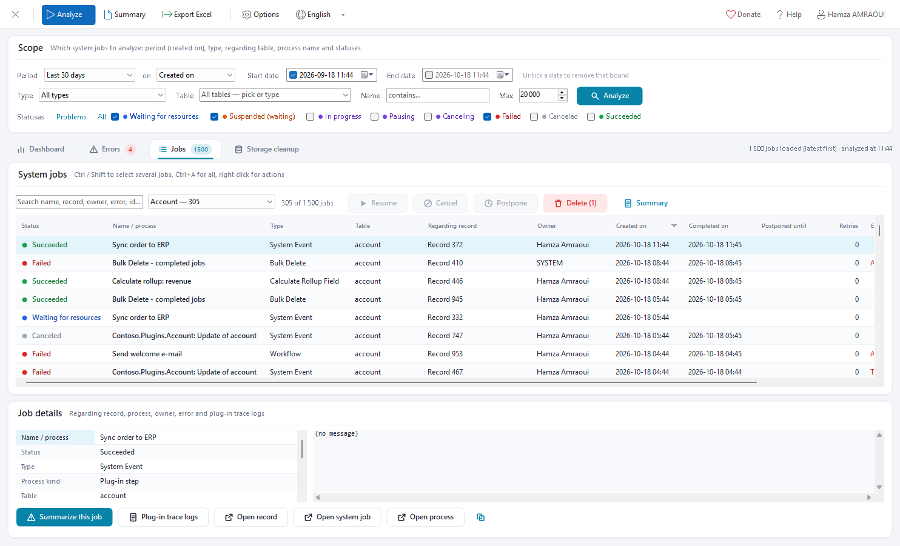
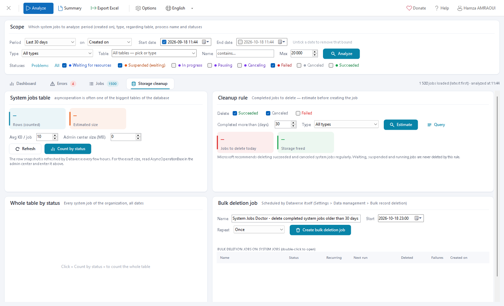

# System Jobs Doctor (XrmToolBox plugin)

Diagnose, fix and clean up the **system jobs** (`asyncoperation`) of a Dynamics 365 / Dataverse organization:

- Why didn't my asynchronous workflow or plug-in run?
- Why are thousands of jobs stuck in *Waiting* or *Suspended*?
- How much storage does the system jobs table use, and how can I clean it up safely?



*Dashboard with sample data: server counts per status, jobs over time, and breakdowns by status, type, table and process.*

---

## Features

| Page | What it does |
|---|---|
| **Dashboard** | Exact **server counts** per status for the scope (aggregate FetchXML). Beyond the 50,000-row aggregate limit, the date range is cut into slices of about 40,000 jobs planned from the table row snapshot. A slice that is still too dense is cut in four, and the slices are counted in parallel (4 queries by default, see **Options**), so a table with a million jobs is counted about 5 times faster than by halving the range sequentially. Also shows a timeline of jobs per day (or per week) and the jobs **by status, type, table and process**. Click a bar or a tile to list the jobs behind it. |
| **Errors** | Error messages are **normalized**: GUIDs, dates, numbers, URLs, e-mail addresses and quoted values are removed, while schema names such as `'new_code'` and error codes such as `0x80040265` are kept. Jobs with the same cause are grouped, for example *1,240 failures = 1 cause*. The page also has the **Top 10 failing processes** (failed + suspended jobs and failure rate), and acts on a whole group at once. |
| **Jobs** | A virtual grid that stays fast with tens of thousands of jobs. You can search, sort and filter it from the drill-downs. The detail pane shows the regarding record, process, owner, dates, retries, error code, correlation id and the full message. Links open the record, the system job and the process (workflow or plug-in step). **Plug-in trace logs** lists the `plugintracelog` rows that share the job's correlation id or request id. |
| **Bulk actions** | **Resume** suspended **and failed** jobs, like the Resume button of Dynamics 365 (back to *waiting for resources*). The state of resumed failed jobs is read again; when the platform did not restart one and it is a workflow, the workflow can be run again on its record (`ExecuteWorkflowRequest`, new system job). Also **Cancel**, **Postpone** (new `postponeuntil`, suspended jobs are put back in the queue) and **Delete** (completed jobs only). They are sent in `ExecuteMultiple` batches, with eligibility checks, a confirmation dialog and a per-job error report. |
| **Storage cleanup** | Shows the table row count (platform snapshot `RetrieveTotalRecordCount`) and an exact count of the whole table by status. A cleanup rule (statuses, *completed more than N days ago*, type) gives an estimate of the jobs that would be deleted and of the storage freed. It then creates a **bulk deletion job** (`BulkDeleteRequest`), once or recurring. The job's condition is relative (`olderthan-x-days`), so a recurring job keeps working. The page also lists the existing bulk deletion jobs that target system jobs. |
| **Failed jobs summary** | Plain-text summary of the failed jobs (optionally the suspended ones too), ready to paste in an e-mail, a ticket or Teams. It covers the counts and share, the worst day, the top causes with their processes, tables, last occurrence, error code and a **hint** for common errors (deleted record, missing privilege, SQL contention, time limit, service protection limits, external service, duplicate, infinite loop, schema change, disabled user, deactivated process). It also lists the failing processes with their failure rate, the tables and the next steps. It can be built from all loaded jobs or from the current job list (filters applied), then copied or saved as .txt / .md. |
| **Excel report** | One `.xlsx` workbook with a summary, the top 10 failing processes, the error groups, every loaded job, and the processes, tables and types. It is written without any third-party library. |

Long operations run behind a loading overlay showing the current step, the progress and the elapsed time. **Stop** (or Esc) stops them between two pages or queries; a stopped analysis keeps the jobs already loaded. A task stuck in a server call is abandoned after 3 seconds and its result ignored.

The interface is in English and French (header ▸ language). The tool is a single DLL with no dependency other than XrmToolBox.







---

## Usage

1. Open **System Jobs Doctor** in XrmToolBox. Nothing is loaded until you click **Analyze**, which asks for a connection if needed. Editing the scope (table, dates, statuses…) never queries the server, and neither does opening a tab: the storage page waits for **Refresh** / **Count by status**.
2. Set the **Scope**:
   - **Period**: a preset fills the **start date** and **end date**. Picking a date switches to *Custom*, and an unticked date means no bound (end date unticked = now). The period applies to the **created on**, **started on** or **completed on** date.
   - **Type**: system event (async plug-ins), workflow, bulk delete, import, rollup or other.
   - **Table**: pick the regarding table in the list or type its name (empty = every table).
   - **Name contains**.
   - **Max**: the number of jobs loaded for the detailed analysis, latest first.
   - **Statuses**. *Problems only* selects *Waiting for resources*, *Suspended* and *Failed*.
   
   Then click **Analyze**, or press Enter in a text box.
3. **Dashboard**: read the server counts, and click any bar or tile to open the matching jobs.
4. **Errors**: select an error group to read the full message. **Show jobs** opens the jobs of the group; **Resume**, **Cancel** and **Delete** act on the whole group.
5. **Jobs**: when the scope has no table, the **table filter** of the list (every table of the loaded jobs, with its count) narrows the grid instantly. Clicking a table on the dashboard selects it. Select jobs (Ctrl / Shift, Ctrl+A), then use the buttons or the right-click menu. The detail pane gives the links and the **Plug-in trace logs**. **Summarize this job** (detail pane or right click) gives a summary of the selected job: what ran and on which record, the cause and its hint, how many other jobs share the same error, the full message, the links and the next steps. With several jobs selected, it summarizes the selection. **Failed jobs summary** summarizes the failures of the list as filtered.
6. **Storage cleanup**:
   - Click **Refresh** for the row snapshot and **Count by status** for the whole table.
   - Choose the rule, then click **Estimate** (and **Query** to see the FetchXML).
   - Then click **Create bulk deletion job**.
7. **Export Excel** saves the report of the current analysis.

### Things to know

- **Resume** only applies to suspended jobs; fix the cause first or they will fail again. **Delete** only applies to completed jobs (succeeded, failed, canceled); cancel the others first. Deleted jobs cannot be restored.
- The analysis loads at most *Max* jobs (default 20,000, see **Options**); the server counts are not limited. When the limit is reached, the header says so.
- When more than 50,000 jobs were created within a 30-second slice, that slice cannot be counted by status. The counts are then shown as lower bounds (≥).
- Plug-in trace logs only exist when *Enable logging to plug-in trace log* is set to *Exception* or *All*, and Dataverse keeps them for 24 hours by default.
- The storage estimate uses an average size per job. Enter the *AsyncOperationBase* size from the Power Platform admin center (*Capacity ▸ Database*) to compute the real average.
- Required privileges: read / write / delete on *System Job*, *Bulk Delete* for the cleanup job, and read on *Plug-in Trace Log*.

---

## Project layout

| Folder | Content |
|---|---|
| `SystemJobsDoctor/` | Plugin project (`SystemJobsDoctor.csproj`, .NET Framework 4.8, SDK-style) |
| `SystemJobsDoctor/Services/` | Dataverse queries with paging (`JobQueryService`), split aggregate counts (`JobCountService`), error normalization, in-memory analysis, bulk actions, cleanup / bulk delete, trace logs, Excel export |
| `SystemJobsDoctor/Models/` | Jobs, statuses, filters, analysis results, action plans, cleanup rule |
| `SystemJobsDoctor/Forms/` | Dialogs: action confirmation, postpone, trace logs, options, text viewer |
| `SystemJobsDoctor/UI/` | Theme, line icons, ToolStrip renderer, and controls drawn with GDI+ (cards, tiles, bar lists, timeline, tabs) |
| `SystemJobsDoctor/Localization/` | English / French strings |
| `docs/images/` | Logo and screenshots |

## Build

```powershell
# Command line
dotnet build SystemJobsDoctor.sln -c Release

# Or MSBuild (Visual Studio)
& "C:\Program Files\Microsoft Visual Studio\18\Community\MSBuild\Current\Bin\MSBuild.exe" SystemJobsDoctor.sln /restore /p:Configuration=Release /v:minimal
```

The output is `SystemJobsDoctor/bin/Release/net48/SystemJobsDoctor.dll`. A Debug build also copies the DLL and its PDB to `%APPDATA%\MscrmTools\XrmToolBox\Plugins` (disable with `-p:DeployToXrmToolBox=false`). `Properties/launchSettings.json` starts `C:\XrmToolBox\XrmToolBox.exe` with F5.

### Install in XrmToolBox

Install from the **Tool Library**, or copy `SystemJobsDoctor.dll` to `%APPDATA%\MscrmTools\XrmToolBox\Plugins` and restart XrmToolBox.

## License

MIT
